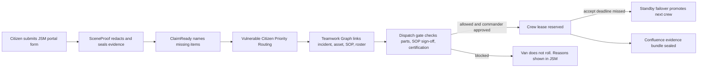
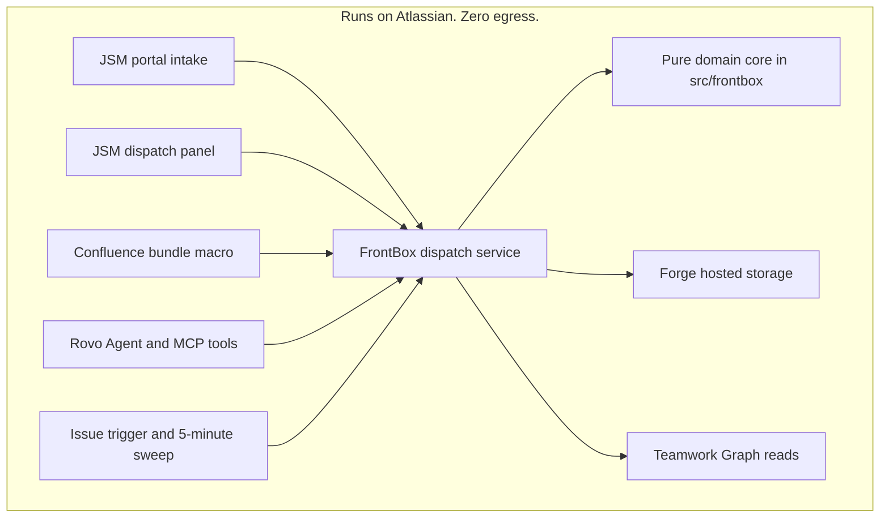

# FrontBox for JSM and Confluence

[](https://github.com/upgradedev/frontbox-atlassian/actions/workflows/ci.yml)
[](https://github.com/upgradedev/frontbox-atlassian/actions/workflows/codeql.yml)
[](LICENSE)

**FrontBox checks JSM incidents against Confluence safety SOPs and spare parts via Teamwork Graph before dispatching field crews with automatic standby failover.**

Kostas Nikolaou, Grid and Field Service Dispatcher at a regional power and water utility, coordinates high-voltage outage crews and emergency standby vans in Jira Service Management (JSM). FrontBox sits inside the JSM incident he already opens. It blocks an unsafe or under-equipped van roll before wheels move, routes vulnerable citizens first, and fails over to the standby on-call technician when the primary crew misses its accept deadline.

Licence: [MIT](LICENSE). Status: deployed for UAT. Try the seeded dispatch core now at the [live demo mirror](https://upgradedev.github.io/frontbox-atlassian/). The Forge app is deployed and installed in Jira on our UAT site (live triage verified on a real JSM issue). The Confluence install waits for the Confluence product to be activated on that site. A public judge distribution link follows from the Developer Console. Install steps below need your own Atlassian Cloud developer site. The dispatch core is fully testable today with the commands under Test.

## Contents

- [What the judge path replaces](#what-the-judge-path-replaces)
- [Quickstart](#quickstart)
- [How it works](#how-it-works)
- [Surfaces](#surfaces)
- [Numbers](#numbers)
- [Scopes and least privilege](#scopes-and-least-privilege)
- [Architecture review notes](#architecture-review-notes)
- [Test](#test)
- [Repo layout](#repo-layout)

## What the judge path replaces

- Surface already open: the JSM incident view, the JSM customer portal request form, and Confluence post-incident pages.
- Trigger that fires alone: a new JSM incident (`avi:jira:created:issue`) starts triage, and a five-minute sweep fails over unaccepted crew leases.
- Replaced work: driving 50 km to a substation without the required transformer part or safety clearance, and phoning through a standby spreadsheet when a crew does not answer.

Remove Atlassian Forge, the Teamwork Graph, the Rovo Agent, and the MCP tools, and FrontBox cannot link the JSM incident to its equipment asset, Confluence Safety SOP, and standby roster. That link is the product.

## Quickstart

Honest time to first result: about 10 minutes with a prepared Atlassian developer site. The local core checks take under a minute and need no Atlassian account.

Prerequisites: Node.js 20 or newer, an Atlassian Cloud developer site with Jira Service Management and Confluence, and Forge CLI access for your Atlassian account.

1. Clone this repo and install dependencies in CI or on a machine with disk space.

   ```sh
   npm install
   ```

   Expected: `node_modules` exists locally. Skip this step to run only the core checks; they need no install.

2. Run the deterministic checks (no account needed).

   ```sh
   node scripts/validate-manifest.js
   node --test
   node scripts/run_triage_eval.js
   ```

   Expected: three PASS lines. The eval prints precision and the unsafe-dispatch blocked rate.

3. Register your own copy of the app once. The committed `app.id` belongs to our UAT app, so remove the `id:` line under `app:` in `manifest.yml` first, then register (first run asks you to name a Developer Space).

   ```sh
   npx forge register "FrontBox for JSM and Confluence" -y
   ```

   Expected: `manifest.yml` now carries your new app id.

4. Deploy and install into your developer site.

   ```sh
   npx forge deploy
   npx forge install
   ```

   Expected: Forge reports a successful deploy, then an install on your chosen Jira and Confluence site.

5. Open any JSM incident, find the FrontBox panel, and tap Seed demo workspace.

   Expected in under 5 steps from install: `GRID-101` loads as ready for commander approval, `GRID-103` blocks on an expired SOP sign-off, and `GRID-104` blocks on a missing van part.

No-atlassian preview: `node scripts/demo-mirror.js` serves the same seeded dispatch core at `http://localhost:4321`. It proves the gate logic only. It is not the Forge product and is labelled as a mirror wherever it appears.

## How it works





Rules that never bend:

- Missing data blocks dispatch. No asset, no signed SOP, no certified crew, no roll.
- A commander approves an exact gate receipt hash. Changed inputs need a new approval.
- Citizen free text is redacted before storage. The seal refuses text that still matches a protected pattern.
- Read paths cannot write. The only mutations run through the Writer port after gate verification.

## Surfaces

| Surface | Manifest module | Key |
| --- | --- | --- |
| Guided SceneProof and ClaimReady citizen intake | `jiraServiceManagement:portalRequestCreatePropertyPanel` | `frontbox-portal-intake` |
| Citizen help status with spoken receipt text | `jiraServiceManagement:portalRequestDetailPanel` | `frontbox-portal-status` |
| Dispatch gate, priority lane, standby lease | `jira:issuePanel` | `frontbox-dispatch-panel` |
| Post-incident evidence bundle | `macro` | `frontbox-evidence-bundle` |
| Assignable dispatch agent | `rovo:agent` | `frontbox-dispatch-commander` |
| MCP tools for Rovo Studio and external clients | `rovo:mcp` | `frontbox-dispatch-mcp-server` |
| New-incident triage | `trigger` on `avi:jira:created:issue` | `frontbox-issue-created-trigger` |
| Failover sweep every five minutes | `scheduledTrigger` | `frontbox-failover-sweep-trigger` |

The agent and the MCP server expose the same four actions: `verify-safety-sop-and-parts`, `match-and-reserve-crew`, `trigger-standby-failover`, `verify-scene-proof-evidence`. External agents get the same playbook in [skills/frontbox-dispatch/SKILL.md](skills/frontbox-dispatch/SKILL.md).

The evidence bundle macro can also publish the sealed bundle as a new Confluence page in a space you name. With no space configured, the bundle stays in Forge storage and the panel says why. Site admins can set the Assets workspace, AQL template, SOP page map, and default evidence space in Forge storage under the key `frontbox:config`.

## Numbers

Every figure below names the command that produces it. Run the command to reproduce the value on this commit.

| Claim | Command |
| --- | --- |
| Incident correlation precision on the 60-pair synthetic fixture, printed as `precision=` | `node scripts/run_triage_eval.js` |
| Unsafe dispatch fixtures blocked, printed as `blockedRate=` with batch time `gateBatchMs=` | `node scripts/run_triage_eval.js` |
| Zero egress keys, Rovo pairing, and surface wiring in `manifest.yml` | `node scripts/validate-manifest.js` |
| Domain and service behavior, including Writer refusals without approval | `node --test` |
| Nine-step end-to-end judge UAT journey across intake, gate, failover, citizen status, bundle, trigger, and HTTP mirror | `node scripts/uat.js` |
| 500-evaluation dispatch gate load smoke budget | `node scripts/load-smoke.js 100` |

The eval fixture is synthetic and says so in its output. It is a regression ruler for the deterministic core, not a field study. No production dispatch data was used.

## Scopes and least privilege

The manifest declares no external fetch allow-list, no remotes, no providers, and no web triggers. Compute runs in Forge functions. State lives in Forge hosted storage and Atlassian content. That shape is what keeps the app eligible for Runs on Atlassian review. Final badge status is Atlassian's decision, not ours, and is not yet granted.

| Scope | Why FrontBox needs it |
| --- | --- |
| `storage:app` | Intake seals, crew leases, and receipts in Forge hosted storage |
| `read:jira-work`, `write:jira-work` | Read the incident. Post gate and failover receipts as comments |
| `read:jira-user` | Show standby crew identities to the dispatcher |
| `read:servicedesk-request`, `write:servicedesk-request` | JSM portal intake and request updates |
| `read:cmdb-object:jira`, `read:cmdb-schema:jira` | Read equipment assets and required parts. Read-only by design |
| `read:page:confluence`, `write:page:confluence` | Read Safety SOP sign-off. Write the post-incident evidence bundle |
| `read:graph:issue:jira` | Teamwork Graph traversal from the incident |
| `read:graph:page:confluence` | Reach the linked Safety SOP page in the graph |
| `read:graph:assets-object:atlassian` | Reach the linked equipment asset in the graph |
| `read:graph:user:atlassian`, `read:graph:team:atlassian` | Reach standby people and teams in the graph |

Inside the code, `Reader` loads product data, the pure domain evaluates, and `Writer` is the only mutation surface. `reserveCrew` refuses without commander approval and the exact receipt hash. Tests exercise both refusals.

## Architecture review notes

Six-pillar self-review (operational excellence, security, reliability, performance, cost, sustainability), scored against this repo only:

| Pillar | What is in place | Residual gap |
| --- | --- | --- |
| Operational excellence | CI runs manifest gate, tests, 9-step UAT, eval, load smoke, CodeQL, OWASP ZAP DAST, and gitleaks on every push; `.github/workflows/forge-deploy.yml` deploys and smoke-tests Jira on `upgradegr.atlassian.net` | Confluence product activation on the UAT site and Developer Console sharing link remain owner console steps |
| Security | Zero egress manifest, project-scoped multi-desk storage isolation (`GRID` vs `ROAD`), redaction before storage, hash-bound approvals, OWASP ZAP baseline in CI | No third-party penetration test against a live Forge tenant |
| Reliability | Fail-closed gate, idempotent seed, parallel graph reads (`Promise.all`), happy-path crew lease acceptance, and 5-minute lease failover sweep | Live Assets AQL and SOP sign-off reads run behind per-site or per-project admin config in Forge storage (`frontbox:config` / `frontbox:config:<SCOPE>`). Unmapped sites block safely |
| Performance | Gate batch measured by `run_triage_eval.js` (`gateBatchMs=2`) and `load-smoke.js 100` (500 checks in under 100 ms) on every CI run | Multi-thousand concurrent webhook burst testing on a live Jira Cloud site is not yet measured |
| Cost | Forge hosted compute and storage only. No external services to pay for. Idle cost ESTIMATE $0 per month inside the Forge free allowance (200,000 GB-seconds per app per month; overage $0.000025 per GB-second), checked 2026-11-03 against [Forge platform pricing](https://developer.atlassian.com/platform/forge/forge-platform-pricing/). FrontBox functions run at 256 MB with millisecond gate checks | Utility-scale incident volume not yet modelled past the free allowance. Rovo LLM credits bill separately and depend on agent chat volume |
| Sustainability | Blocked wasted truck rolls are the core saving | Fuel saving per blocked roll is not yet measured in the field |

EU AI Act (Regulation EU 2024/1689), article by article for the agent surface:

| Article | What FrontBox does | Residual gap |
| --- | --- | --- |
| 10 Data governance | Synthetic demo data only. Citizen text redacted before storage | Real deployments need a customer data agreement per operator |
| 13 Transparency | Agent prompt orders verbatim tool results and named missing inputs | End-user wording not yet reviewed by native speakers per locale |
| 14 Human oversight | No dispatch without commander approval of an exact receipt hash. Spoken receipt text and SSML ship in the dispatch and citizen panels | Approval UX is a panel button. In-browser audio playback needs a Custom UI surface and is not shipped |
| 15 Accuracy and robustness | Deterministic gate. Eval harness in CI with a failing threshold | Correlation precision measured on a synthetic fixture only |
| 50 Disclosure | Agent and tools are named as FrontBox automation in JSM receipts | Marketplace listing copy still to be written and reviewed |

GDPR data map, short form: the demo processes no real personal data. A live install stores redacted intake text, a callback channel label (for example `sms`), vulnerable-citizen flags the reporter ticked, crew ids, and hashes. Storage is Forge hosted storage inside the customer's Atlassian site. Retention follows the customer's site policy. Raw phone numbers, emails, card numbers, IBANs, and plates are replaced by tokens before the seal is stored. Reproduce the redaction behavior with `node --test tests/scene-proof.test.js`.

## Test

```sh
node scripts/validate-manifest.js
node --test
node scripts/uat.js
node scripts/run_triage_eval.js
node scripts/load-smoke.js 100
node scripts/demo-mirror.js
```

The first five commands need no install and no Atlassian account. The mirror then serves the interactive Command Center and seeded incidents at `http://localhost:4321`, with dispatcher JSON at `/api/incidents/GRID-101`, citizen JSON at `/api/status/GRID-101`, interactive simulator script at `/mirror-app.js`, and health at `/healthz`.

Forge-side checks run in CI on every push (authenticated `forge lint`) and in the Forge Deploy workflow. To repeat them with your own Atlassian account: `npm install`, set `FORGE_EMAIL` and `FORGE_API_TOKEN`, then `npx @forge/cli@15 lint`.

## Repo layout

```text
manifest.yml                  Forge modules, scopes, Zero Egress shape
src/frontbox/                 Pure domain core. Zero Forge imports.
src/forge/                    Forge adapters: ports, resolvers, actions, triggers, seed
src/frontend/                 UI Kit panels for portal, dispatch, Confluence
src/index.js                  Forge entry point. Wiring only.
skills/frontbox-dispatch/     MCP skill playbook for external agents
scripts/                      Manifest gate, 9-step UAT, triage eval, load smoke, interactive mirror
tests/                        Node test suite for the core and gates
```

Build order inside one incident: seal, completeness, priority, graph link, gate, approval, lease, failover, bundle. Each step is a small pure function with a test beside the behavior it protects.
